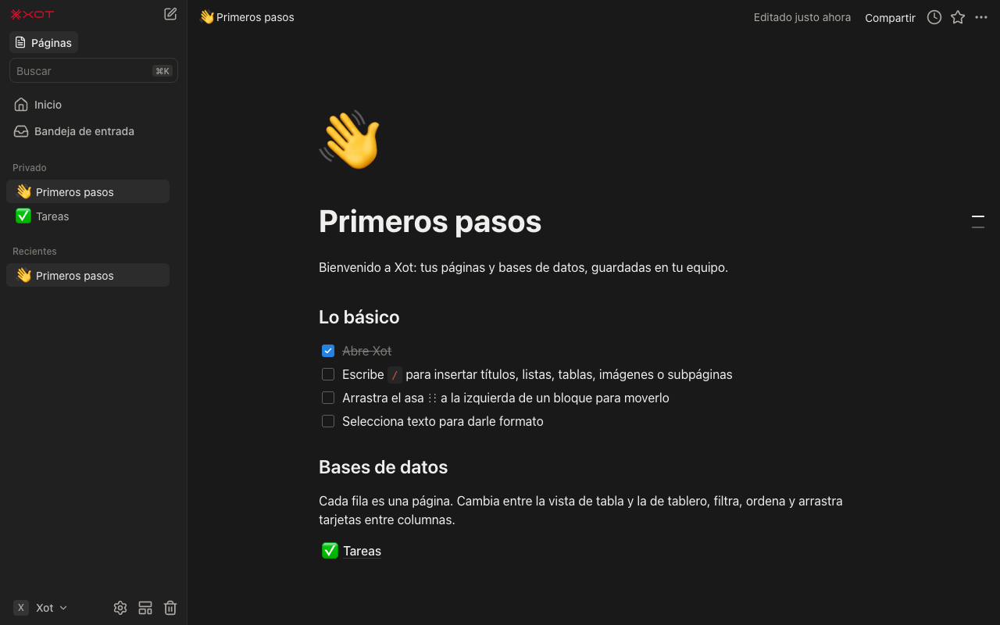

# Xot

Páginas, bases de datos y automatizaciones, **guardadas solo en tu equipo**. Sin servidor, sin cuentas y sin enviar tus datos a ningún sitio.

*A local-first workspace for macOS. Everything stays on your Mac. The interface is in Spanish.*



## Descargar e instalar (macOS)

1. Descarga `Xot-<versión>-universal.dmg` desde [Releases](https://github.com/Rotzebra/xot/releases/latest). Funciona en Mac con Apple Silicon e Intel, con macOS 13 o posterior.
2. Abre el DMG y arrastra **Xot** a **Aplicaciones**.
3. La app no está firmada con una cuenta de desarrollador de Apple, así que la primera vez macOS la bloquea con el aviso «Xot está dañado» o «no se puede verificar el desarrollador». Para abrirla, ejecuta esto una vez en Terminal:

   ```bash
   xattr -dr com.apple.quarantine /Applications/Xot.app
   ```

   También puedes intentar abrirla, ir a **Ajustes del Sistema → Privacidad y seguridad** y pulsar **Abrir igualmente**.

Las siguientes veces se abre con normalidad.

## Qué incluye

- **Editor de bloques**: menú `/`, títulos, listas, tareas, desplegables, citas, recuadros destacados, código con resaltado y diagramas Mermaid, ecuaciones, columnas, pestañas, tablas, imágenes, vídeo, archivos, marcadores, menciones `@` de páginas y fechas, recordatorios, buscar y reemplazar, y selección y arrastre de varios bloques.
- **Bases de datos**: todo tipo de propiedades (texto, número, selección, estado, fecha, personas, archivos, fórmulas…), relaciones bidireccionales, rollups y un lenguaje de fórmulas con editor, autocompletado y ayuda.
- **Vistas**: tabla, tablero, lista, galería, calendario, cronología con dependencias, gráfico, panel, formulario y mapa. Cada vista tiene filtros avanzados, orden, agrupación, cálculos, subelementos y color condicional.
- **Automatizaciones y botones**: disparadores al añadir una página, al editar una propiedad o de forma recurrente; acciones para editar o añadir páginas, notificar o enviar un webhook; variables y fórmulas en los valores.
- **Plantillas**: plantillas de base de datos, predeterminadas por vista y repetidas, más una galería local.
- **Navegación**: barra lateral con favoritos y arrastrar y soltar, búsqueda `⌘K` con filtros, pestañas, bandeja de entrada, historial de versiones, papelera y páginas verificadas.
- **Importar y exportar**: Markdown, CSV, HTML, Word, Excel, PDF y archivos `.zip` exportados; exporta a Markdown, HTML, CSV y PDF, o todo el espacio de trabajo en un `.zip`.
- **App de escritorio**: atajo global de búsqueda, icono en la barra de menús, notificaciones, insignia en el Dock y apertura al iniciar sesión.

## Tus datos

Todo vive en `~/Library/Application Support/Xot`, en una base IndexedDB local. Para hacer una copia de seguridad, usa **Configuración → Exportar** o copia esa carpeta. Xot solo se conecta a internet para cargar recursos que tú pides, como imágenes por URL, vistas previas de enlaces o teselas del mapa, y para los webhooks que tú configures.

## Compilar desde el código

Requiere Node.js 22 o posterior.

```bash
npm install
npm run dev            # versión web en http://localhost:5173
npm run app:dev        # app de escritorio en modo desarrollo
npm run app:build      # release/mac-arm64/Xot.app
npm run app:dmg        # DMG universal (Apple Silicon + Intel) en release/
```

Estructura:

- `src/lib`: modelo de datos (`block`, `collection`, `collection_view`), IndexedDB con Dexie, operaciones, filtros, fórmulas, automatizaciones e importadores.
- `src/components`: barra lateral, páginas y editor (BlockNote).
- `src/components/database`: vistas, propiedades, fórmulas y automatizaciones.
- `electron`: proceso principal de la app de escritorio.
- `brand`: logotipos e isotipos de Xot en SVG, PNG e Illustrator.

## Licencia

[GPL-3.0](LICENSE). Xot usa `@blocknote/xl-multi-column`, que se distribuye bajo GPL-3.0, por lo que las versiones derivadas que se distribuyan también deben publicar su código bajo GPL-3.0.
